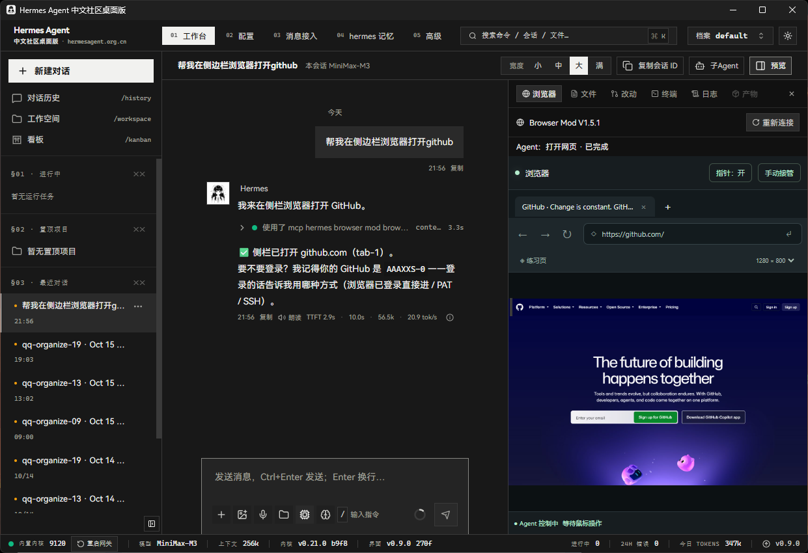

# Hermes Browser Mod · V1.6.0

面向 Windows 的非官方 Hermes 伴随式浏览器与中文桌面 mod：Agent 在独立 Edge 中浏览，你可以在侧栏看见操作、手动接管，并继续使用自己的系统鼠标键盘。

独立 stdio MCP 服务提供 16 个工具；可选接入 **Hermes Agent CN Desktop v0.9.0** 的原生预览栏。它不是 Chrome 扩展，也不是官方 Hermes Desktop SDK 插件。目前不承诺其他桌面版本、操作系统或远程 Hermes 兼容。



*图为 CN Desktop v0.9.0 + 本地 Mod V1.5.1 的实际运行界面；当前公开源码版本为 V1.6.0。*

## 能做什么

- 独立项目 profile 与标签页、导航、实时 JPEG 画面，不复用日常浏览器登录资料。
- DOM ref、跨域及嵌套 iframe、截图坐标点击、悬停、逐字中文/英文输入。
- 可见指针与点击落点；手动接管后 Agent 操作暂停，用户交还后继续。
- 当前对话使用本 mod 工具时，原生侧栏自动展开，并显示最近动作及完成/失败状态。
- 独立 MCP、薄插件和原生 UI 指向分别管理；安装器检查文件归属，支持还原。
- 网页弹窗可独立处理，避免与普通动作队列互相等待；离开确认明确区分“留在此页 / 离开此页”。

## 环境与兼容性

需要 Windows、Node.js 22+、npm、Microsoft Edge。原生桌面接入还需 Git，以及已安装并至少启动过一次的 CN Desktop **v0.9.0 / 270f6ba**（配套 Core 0.21.x）。先在宿主“关于”页面核对版本，其他版本不要套用此前端副本。

公开源码中的路径均为用户配置或示例；不会假定某个盘符已安装 Hermes。构建原生 UI 需下载固定上游源码与依赖。详见 [兼容范围与架构](docs/ARCHITECTURE.md)。

## 1. 独立试用

在本仓库目录运行：

```powershell
npm ci
npm start
```

也可双击“启动 demo.cmd”。默认服务地址为 http://127.0.0.1:17371 。先用界面的练习页验证实时画面、指针和手动中文输入，再打开实际网站。

关掉界面不等于停止后台；停止使用 npm run stop 或“停止 demo.cmd”。profile、下载、连接凭据和测试数据在被 Git 忽略的 .runtime 内。不要公开上传这个目录。

## 2. 接入 Hermes MCP

先选择你自己的 Hermes home（包含 config.yaml 的目录），以下是示例路径：

```powershell
$env:HERMES_HOME = "C:\Apps\HermesDesktop\data\hermes-home"
npm run hermes:connect
```

安装器只添加 mcp_servers.hermes-browser-mod 项，其他配置保留；已有同名但不同内容时拒绝覆盖。未指定 home 时回退到用户目录下的 .hermes；这不一定是你的桌面数据目录，建议始终显式指定。之后在 Hermes 重载 MCP，或完整重启 Hermes。也可手工接入：

```yaml
mcp_servers:
  hermes-browser-mod:
    command: node
    args: ["C:/Tools/HermesBrowserMod/src/mcp.mjs"]
    timeout: 60
    connect_timeout: 30
```

将示例 args 换成你的项目绝对路径，确保 Hermes 能找到 Node。MCP 自动启动本项目后台，不会为每个聊天新建独立浏览器。

给 Hermes 的建议提示：

> 使用 hermes-browser-mod 操作浏览器。先 browser_snapshot，使用最新 ref；点击后核对实际目标。DOM 无法定位时，再基于最新 browser_screenshot 调用 browser_click_at 或 browser_hover_at。需要我登录时 browser_release_control，等待我交还。遇到网页弹窗用 browser_handle_dialog，处理后重新读取页面，不盲目重试旧点击。

## 3. 可选：接入 CN 原生桌面侧栏

只使用独立 MCP 时无需本节。此步骤构建并加载修改后的宿主前端，受上游非商业许可约束，见 [第三方声明](THIRD_PARTY_NOTICES.md)。

```powershell
# 换成你的 CN Desktop 安装目录；此目录下应有 data 文件夹。
$env:HBM_HERMES_DESKTOP_ROOT = "C:\Apps\HermesDesktop"
# 若此前手工设置过 HERMES_HOME，请确保仍指向同一宿主的正确配置。
$env:HERMES_HOME = "$env:HBM_HERMES_DESKTOP_ROOT\data\hermes-home"
npm run native:prepare
npm run native:build
npm run desktop:install
```

安装目录也可作为命令参数：

```powershell
npm run desktop:install -- --desktop-root "C:\Apps\HermesDesktop"
```

已有自定义数据目录时，可使用 --runtime-root 指定包含 ui 和 hermes-home 的 runtime，再用 --home 指定当前 Hermes home；对应环境变量为 HBM_HERMES_RUNTIME_ROOT、HERMES_HOME。缺少原生 runtime 配置时拒绝安装。同名命令行配置优先于环境变量；显式 home/runtime 配置（含环境变量）优先于从 desktop-root 推导的路径。

安装器复制本项目薄插件并管理自身启用项，保存并修改宿主 data/ui/current.json，使其指向本项目 .runtime/native-ui/V1.6.0。它不替换安装 EXE、Rust 宿主或 Agent 核心。构建是本地 mod，不是官方签名更新。

完整重启 Hermes 后，打开对话 → 预览 → 浏览器。后续当前对话使用本 mod 工具时会自动展开；其他会话、内置 browser_exec 和其他浏览器 MCP 不触发。文件页有未保存修改时会先保留草稿并提示。

桌面薄插件与 MCP 适配器独立安装，请完成第 2 节，否则 Hermes 不会自动获得这些工具。旧 Dashboard 插件前端保留，但它与原生 Tauri 界面是两套接口。

## 更新与卸载

如果已有其他目录安装的同名本地 mod，请先从原目录撤销桌面集成和 MCP，再由新目录接入；保留原接入记录直到撤销完成，不通过删除记录绕过归属检查。

更新 mod 前先停止后台，在方便时完整重启 Hermes，避免新 MCP 连接旧服务时版本不匹配。更新源码后按新版本重新构建、安装。登录 profile 保留；重启浏览器后需重新打开网站。

撤销桌面集成需设置与安装时相同的路径：

```powershell
npm run desktop:remove -- --desktop-root "C:\Apps\HermesDesktop"
# 使用自定义 home/runtime 时，同时提供安装时的 --home / --runtime-root。
npm run hermes:disconnect
npm run stop
```

随后重启 Hermes。保留 .runtime 中的接入记录直到完成撤销；安装器不会删除登录 profile 或其他插件。若宿主更新或用户改写了受管理文件/指向，安装器会拒绝覆盖或删除，先核对记录。项目目录移动后需重新接入 MCP；原生 UI 指向也依赖绝对路径。

## 限制与数据

- 多个聊天共享同一浏览器；不会将每个聊天隔离成独立 profile。自动展开只跟随当前可见对话。
- 模型对 DOM/截图的判断可能出错；点击成功不代表完成任务。登录、验证码及关键操作应由用户核对。
- 页面通过 JPEG 画面流展示，不是目标页面 DOM 嵌入；暂不提供音频转发、完整视频、拖放上传或 Windows 桌面控制。
- screenshotId 与 ref 会失效，只使用最新结果；封闭 Shadow DOM、特殊变换和站点反自动化仍需个别验证。
- 本地服务长期运行到用户停止。访问目标网站会向该网站发送请求；profile 会保存用户主动登录产生的 cookie/会话。服务不主动收集遥测。详见 [数据与安全边界](SECURITY.md)。

## 开发与发布

```powershell
npm run check
npm test
npm run release:check
```

测试使用独立 profile 与配置 fixture，不操作真实账号。Windows CI 验证 mod 的语法和端到端测试；原生组件需对应宿主源码 workspace 验证。实际通过范围见 [验证记录](docs/TESTING.md)。

贡献见 [CONTRIBUTING.md](CONTRIBUTING.md)，推送步骤见 [PUBLISHING.md](PUBLISHING.md)，版本演进见 [CHANGELOG.md](CHANGELOG.md)。这是从本地 V1.5.1 导出的全新公开历史，未复制私人会话文档、旧 Git 对象或运行数据。

## 许可

原创 mod 代码以 [MIT](LICENSE) 发布。上游 CN Desktop 源码与修改后前端仍遵循其 PolyForm Noncommercial 1.0.0，必须保留声明，商业用途另需上游授权。MIT 不把整个宿主前端变成可商用的 MIT 软件。见 [THIRD_PARTY_NOTICES.md](THIRD_PARTY_NOTICES.md)。本项目非官方，与同名浏览器扩展/云浏览器插件并非同一项目。
