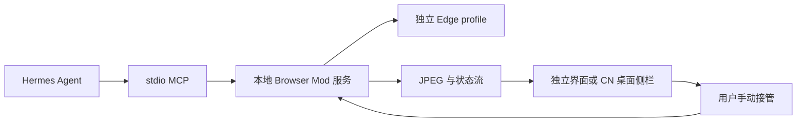

# 架构与兼容范围

支持层次：独立 Node + Edge 服务；标准 stdio MCP；可选 Dashboard 薄启动桥；可选固定版本 CN Tauri 原生前端接入。

DOM 操作由 Playwright 定位真实元素；截图坐标对应独立浏览器视口，不是 Windows 屏幕坐标。模型和手动界面操作同一个浏览器，不移动系统鼠标。跨域 iframe 的读取依赖 Playwright frame 访问，并非把 iframe DOM 暴露给嵌入侧栏。

原生 UI：固定 Hermes CN Desktop v0.9.0 commit 270f6ba796a291cf1397b63dee5cd697cb0c9cdf，配套 Core 0.21.x。构建脚本只添加预览栏 BrowserModTab 和当前对话工具事件 hook。原宿主 Rust、EXE、模型循环不改。旧 Dashboard 插件不是原生桌面插件 SDK，二者验收不能互相替代。

原生接入受上游 PolyForm Noncommercial 限制。源码包不附宿主构建；由用户按固定源码构建时，输出保留两方 LICENSE 与第三方声明。宿主 UI 更新可能覆盖当前 mod 指向；其他宿主版本必须重新核对结构与兼容性，不能直接套用。

运行数据与安装记录在项目 .runtime。MCP、薄插件、原生 UI 指向的记录相互独立；撤销面板不自动撤销 MCP。更换项目位置或丢弃记录可能使原路径失效，应先撤销、再迁移、再安装。
